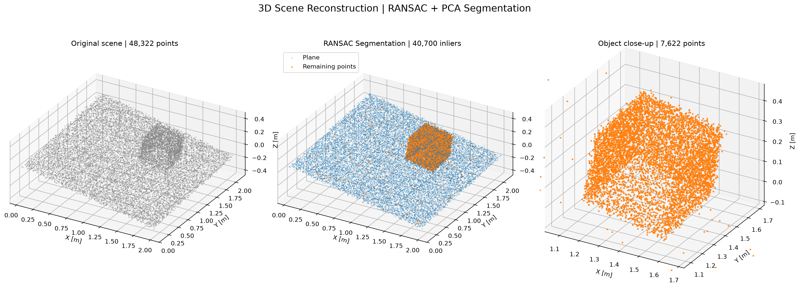

# 3D Point Cloud Reconstruction – PCA & RANSAC

A C++ framework for 3D point cloud processing, plane estimation, and geometric segmentation. The project serves as a foundation for future **robotic 3D mapping and SLAM development using ROS 2**.

## Overview

The project implements two experimental pipelines:

**1. Synthetic Validation**

A 3D scene containing a plane and a cube is generated, transformed, and corrupted with Gaussian noise. PCA estimates the plane orientation, while **RANSAC + PCA refinement** provides robust estimation in the presence of outliers.

Monte Carlo simulations evaluate the influence of measurement noise.

**2. Real-World Reconstruction**

Real depth images captured with an **Intel RealSense D455** are converted into 3D point clouds using the pinhole camera model.

RANSAC and PCA are then used to detect the dominant plane, segment remaining points, and reconstruct a height map relative to the detected surface.

## Results

| Metric | Result |
|---|---:|
| Synthetic scene | 48,322 points |
| RealSense point cloud | 347,474 points |
| RANSAC plane inliers | 339,796 |
| Real-world plane RMSE | 2.20 mm |

*Real-world results use approximate camera intrinsics and an assumed depth scale.*

## Technologies

C++20 · Eigen · OpenCV · CMake · Python · NumPy · Matplotlib

## Documentation

For the mathematical derivations, algorithm implementation, experimental methodology, and detailed results, see the full technical report:

**[Technical Report – PCA, RANSAC & RealSense D455 (PDF)](results/reports/Porocilo_PCA_RANSAC.pdf)**

## Future Development

ROS 2 integration, multi-view 3D reconstruction using known robot poses, point cloud registration, and SLAM.