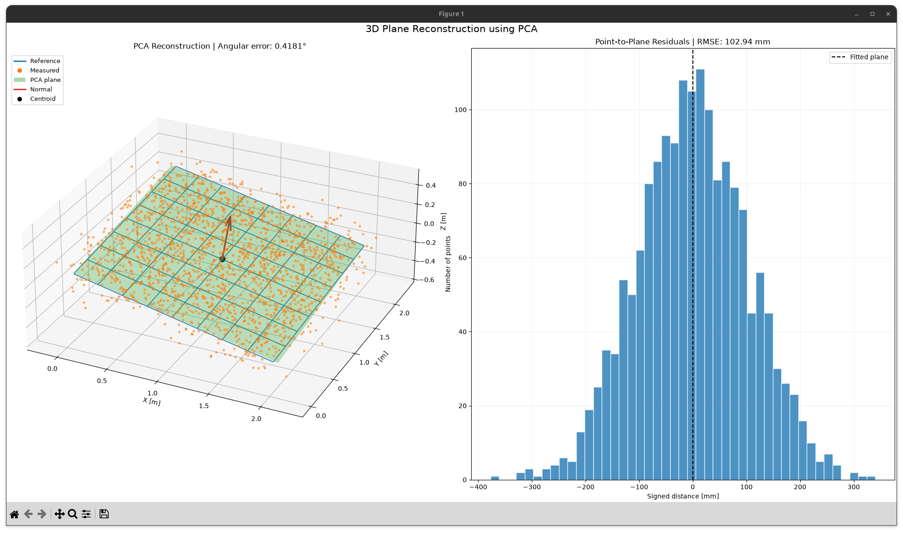

# 3D Plane Reconstruction using PCA

This project is an initial step toward 3D point cloud processing, mapping, and SLAM.

A synthetic planar point cloud is generated, rotated, and translated in 3D space. Gaussian noise is then added to simulate measurement uncertainty.

The original plane is reconstructed from the noisy measurements using **Principal Component Analysis (PCA)**. The method estimates the plane's normal vector and position through centroid computation and covariance matrix eigendecomposition.

Reconstruction accuracy is evaluated using angular error, point-to-plane RMSE, and centroid error. Monte Carlo simulations are performed to investigate the influence of measurement noise.

**Technologies:** C++20, Eigen, CMake, Python, NumPy, Matplotlib.

### Results

For a 2 × 2 m plane containing 1,681 points, with Gaussian noise (σ = 100 mm) and 100 Monte Carlo iterations:

| Metric              | Mean error |
| ------------------- | ---------: |
| Angular error       |    0.2971° |
| Point-to-plane RMSE |   99.65 mm |
| Centroid errorSLAM  |    4.08 mm |

